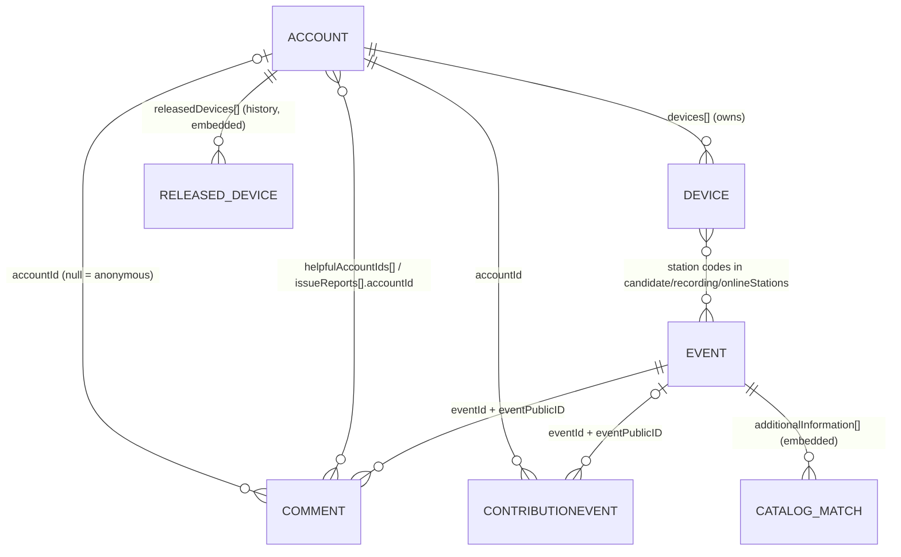

# Database Schema Guide

Everything you need to understand the Earthquake Hub database: what each collection holds, how the collections relate, which code writes what, and the rules and gotchas that aren't obvious from the model files.

- **Engine:** MongoDB 8.0 (single-node replica set `rs0`, auth on), accessed through Mongoose 8.
- **Database name:** `latestEQs` (`MONGO_NAME` in `.env`).
- **Source of truth for fields:** the model files in [`src/models/`](src/models/). This document explains them; if the two ever disagree, the model wins, and this file should be fixed in the same PR.
- **Setting up and connecting** (Docker, `.env`, Compass): see [MONGODB.md](MONGODB.md).

---

## Contents

1. [The big picture](#1-the-big-picture)
2. [Collections at a glance](#2-collections-at-a-glance)
3. [Relationships](#3-relationships)
4. [Collections in detail](#4-collections-in-detail)
   - [events](#41-events)
   - [accounts](#42-accounts)
   - [devices](#43-devices)
   - [comments](#44-comments)
   - [contributionevents](#45-contributionevents)
   - [subscriptions](#46-subscriptions)
   - [significant-eqs](#47-significant-eqs)
   - [joblocks](#48-joblocks)
5. [How data flows](#5-how-data-flows)
6. [Conventions and gotchas](#6-conventions-and-gotchas)
7. [Migration and maintenance scripts](#7-migration-and-maintenance-scripts)
8. [Known issues and tech debt](#8-known-issues-and-tech-debt)
9. [Changing the schema: checklist](#9-changing-the-schema-checklist)
10. [Glossary](#10-glossary)

---

## 1. The big picture

Earthquake Hub collects earthquakes detected by **SeisComP** (UPRI's seismic processing system) from a network of citizen-hosted **Raspberry Shake** sensors, and shows them on a public map.

```
Raspberry Shake sensors ──stream──▶ ringserver ──▶ SeisComP ──detects quake──▶ backend ──▶ MongoDB
         (devices)                  (stream status ─────────────────────────▶ backend)        │
                                                                                               ▼
                      citizens, barangays, admins ◀── frontend (map, event pages, reports) ◀── API
```

The database stores four kinds of things:

| Kind | Collections |
|---|---|
| **Earthquakes** and what we know about them | `events`, `significant-eqs` |
| **People** and their **sensors** | `accounts`, `devices` |
| **Community input** on earthquakes | `comments`, `contributionevents` |
| **Infrastructure** state | `subscriptions` (web push), `joblocks` (background job mutex) |

The backend does **no seismic processing**. Magnitude, location and origin time all come from SeisComP. The backend stores them, enriches them (place names, matching PHIVOLCS/USGS reports, which stations recorded the quake) and serves them.

---

## 2. Collections at a glance

| Collection | Model file | Mongoose model | What one document is | Main writers |
|---|---|---|---|---|
| `events` | `events.model.js` | `Event` | One earthquake detected by SeisComP | SeisComP via `/messaging`, enrichment job, station refinement, users editing the summary |
| `accounts` | `account.model.js` | `Account` | One user (citizen, barangay, admin) | Registration, profile settings, device link/unlink |
| `devices` | `device.model.js` | `Device` | One Raspberry Shake sensor | Device linking, ringserver stream status, alert-credential setup |
| `comments` | `comments.model.js` | `Comment` | One community report on an earthquake | Public report form, helpful/issue buttons, admin moderation |
| `contributionevents` | `contributionEvent.model.js` | `ContributionEvent` | One points-earning action (ledger entry) | Comments service |
| `subscriptions` | `subscription.model.js` | `Subscription` | One browser's web-push subscription | Notifications service, cleanup scheduler |
| `significant-eqs` | `significantEQ.model.js` | `significant-eq` | One hand-curated notable earthquake | Nobody in the app (curated directly in the database) |
| `joblocks` | `jobLock.model.js` | `JobLock` | One lock held by a background job | Enrichment job |

Rough sizes on a copy of real data (Oct 2026): ~900 events, ~85 accounts, ~26 devices. All collections are small today; the indexes are there so they stay fast as they grow.

---

## 3. Relationships



How each link is stored:

| From | To | Stored as | Notes |
|---|---|---|---|
| account → devices | `devices` | `accounts.devices[]` (array of `devices._id`) | Ownership lives **on the account side only**. "Who owns device X?" is answered with `Account.findOne({ devices: X })`. A device has at most one owner (enforced by `linkDevice`, not by the database). |
| account → released devices | (embedded) | `accounts.releasedDevices[]` | A snapshot of each device the account unlinked. History only. |
| comment → event | `events` | `comments.eventId` (ObjectId) **and** `comments.eventPublicID` (SeisComP ID) | Both are kept; queries use either. |
| comment → author | `accounts` | `comments.accountId` | `null` for anonymous reports. `username` is copied onto the comment. |
| comment → helpful voters | `accounts` | `comments.helpfulAccountIds[]` | One entry per account. |
| comment → issue reporters | `accounts` | `comments.issueReports[].accountId` | Private moderation signals. |
| contribution → account / event | `accounts`, `events` | `accountId`, `eventId`, `eventPublicID` | Ledger of points. |
| event → stations | `devices` | `events.candidateStations[]`, `recordingStations[]`, `onlineStations[]` | **Station codes** (e.g. `R3B2D`), not ObjectIds. They match `devices.station`. |

There are **no foreign-key constraints** in MongoDB. Deleting an account or event does not delete or update the documents that point to it; the code that deletes is responsible for clean-up.

---

## 4. Collections in detail

Legend for the field tables: **Req** = required by the schema. Defaults are applied by Mongoose when a document is created through the model (not when you insert directly with `mongosh` or `.collection.insertOne`).

### 4.1 `events`

One document per earthquake, keyed by SeisComP's `publicID`. Field names like `OT` and `latitude_value` mirror SeisComP's naming and are part of the public API, so they're kept as-is.

#### Core earthquake data (from SeisComP)

| Field | Type | Req / default | Notes |
|---|---|---|---|
| `_id` | ObjectId | auto | Internal ID. Comments reference it as `eventId`. |
| `publicID` | String | **Req**, unique | SeisComP event ID, e.g. `upri2026tqzx`. The stable public identifier used in URLs. |
| `OT` | Date | | **Origin time** of the earthquake (UTC). |
| `latitude_value` | Number | | Epicenter latitude, −90…90. |
| `longitude_value` | Number | | Epicenter longitude, −180…180. |
| `location` | GeoJSON Point | absent if coordinates invalid | **Derived** from `latitude_value`/`longitude_value` on every write: `{ type: 'Point', coordinates: [longitude, latitude] }`. Used for `$near`/`$geoWithin` queries. Never set it by hand. |
| `depth_value` | Number | | Depth in km. |
| `magnitude_value` | Number | | Magnitude. |
| `type` | String | | Latest SeisComP message type: `NEW` or `UPDATE`. |
| `text` | String | | SeisComP's region description. |
| `last_modification` | Date | | SeisComP's modification timestamp. Used to **ignore out-of-order updates**: an incoming update older than this is dropped. |

#### Provenance

| Field | Type | Req / default | Notes |
|---|---|---|---|
| `sourceCatalog` | String | `'upri-current'` | Which catalog the event came from (`EVENT_SOURCE_CATALOG`). |
| `sourceServer` | String | | SeisComP server name. |
| `sourceSeiscompVersion` | String | | SeisComP version that produced it. |
| `isLegacyRecord` | Boolean | `false` | `true` for events imported from an older catalog. Reset to `false` if SeisComP later sends the same `publicID`. |
| `legacyImportedAt` | Date | | When the legacy import happened. |
| `legacySourcePublicID` | String | | The event's ID in the legacy catalog. |

#### Place name (Geoserve)

| Field | Type | Notes |
|---|---|---|
| `place` | String | Human-readable place, e.g. "12 km NE of Baler, Philippines". **Filled lazily**: when the event list or detail is read and `place` is missing or a placeholder, the backend asks Geoserve and saves the answer. It's **cleared** whenever an update moves the epicenter by more than `GEOSERVE_PLACE_REFRESH_DISTANCE_KM` (1 km), so the next read recomputes it. |

#### Stations that recorded the quake

These answer "which sensors near the epicenter actually recorded this earthquake?". All three arrays hold **station codes** (uppercase), nearest first.

| Field | Type | Default | Notes |
|---|---|---|---|
| `candidateStations` | [String] | `[]` | Active stations nearest to the epicenter **at ingest time**. A guess, not a confirmation. |
| `recordingStations` | [String] | `[]` | Stations **confirmed** by FDSN to have waveform data for the event window. |
| `onlineStations` | [String] | `[]` | What the UI shows. Derived from the two above depending on the status (see [5.2](#52-recording-availability-which-stations-recorded-the-quake)). Kept for API compatibility. |
| `recordingAvailabilityStatus` | String enum | `'pending'` | `pending` · `partial` · `verified` · `unavailable`. |
| `recordingAvailabilityCheckedAt` | Date | | Last FDSN check. |
| `recordingAvailabilityAttempts` | Number | `0` | FDSN check count; stops retrying at `RECORDING_AVAILABILITY_MAX_ATTEMPTS` (4). |

#### Catalog enrichment (PHIVOLCS / USGS)

The enrichment job looks for the same earthquake in the PHIVOLCS and USGS catalogs and stores the best match from each.

| Field | Type | Default | Notes |
|---|---|---|---|
| `additionalInformation` | [CatalogSource] | `[]` | One entry per matched source. Sub-schema below. |
| `pendingCatalogSources` | [String] | `['phivolcs', 'usgs']` | Sources still to try. The job only picks events where this isn't empty. |
| `catalogEnrichmentStatus` | Map<String, String> | `{}` (set to `pending` per source on insert) | Per source: `pending` · `done` (match saved) · `no_match` (searched, nothing close enough) · `failed` (gave up after `MAX_ENRICHMENT_ATTEMPTS`). |
| `catalogEnrichmentAttempts` | Map<String, Number> | `{}` | Per-source attempt counter. |
| `upForEnrichment` | Boolean | `true` | **Legacy.** Old global "needs enrichment" flag. Still read and written by the enrichment job for old records; kept on purpose (see [section 8](#8-known-issues-and-tech-debt)). |
| `enrichmentAttempts` | Number | `0` | **Legacy.** Old global attempt counter. Same status as `upForEnrichment`. |

**`additionalInformation[]` entry (CatalogSource)** — `_id: false`, `strict: false` (unknown keys from upstream are stored too):

| Field | Type | Notes |
|---|---|---|
| `source` | String, **Req** | `phivolcs` or `usgs`. |
| `sourceLabel`, `sourceIconUrl` | String | Display name and icon. |
| `id`, `title`, `place`, `location`, `detail` | String | The upstream event's identifiers and descriptions. |
| `url`, `detailUrl`, `queryUrl` | String | Links to the upstream page / API query. |
| `time` | Date | Upstream origin time. `dateTime` (String) is the raw text PHIVOLCS shows (Philippine time, GMT+8). |
| `latitude`, `longitude`, `depth`, `depthKm`, `magnitude` | Number | Upstream values. |
| `hasFeltIntensity` | Boolean | Upstream has felt-intensity reports. Copied, not computed. |
| `distanceKm`, `timeDifferenceMinutes`, `magnitudeDifference` | Number | How far the upstream event is from ours. |
| `latitudeFloorMatch`, `longitudeFloorMatch` | Boolean | Whether whole-degree coordinates match. |
| `score` | Number | Match score (lower is better). |
| `matchQuality` | String | `high` (≤2 min, ≤100 km, ≤0.5 mag) · `medium` (≤5 min, ≤250 km, ≤1.0) · `low` (≤10 min, ≤500 km, ≤1.5). |
| `raw` | Mixed | The full upstream payload. Can be large. |

#### Community summary

| Field | Type | Notes |
|---|---|---|
| `summaryOverride` | `{ text (Req), editedAt (default now), editedBy }` or `null` | A user-edited summary that replaces the generated one. Set/removed via `PATCH`/`DELETE /eq-events/:publicID/summary` (admins and citizens). `editedBy` is a username or account ID. |

Every event also has `createdAt` and `updatedAt` (Mongoose timestamps).

#### Indexes

| Index | Used by |
|---|---|
| `publicID_1` (unique) | Event detail page, ingest upsert, comment lookups |
| `OT_-1` | Event list (time range), enrichment job (`OT <= cutoff`, oldest first) |
| `location_2dsphere` | Location queries (`$near`, `$geoWithin`) |
| `sourceCatalog_1`, `isLegacyRecord_1` | Catalog / legacy filters |
| `recordingAvailabilityStatus_1` | Finding events still being checked |
| `pendingCatalogSources_1` | Enrichment job eligibility |
| `upForEnrichment_1` | Legacy enrichment eligibility |

---

### 4.2 `accounts`

One document per user. A user can have several roles.

| Field | Type | Req / default | Notes |
|---|---|---|---|
| `_id` | ObjectId | auto | |
| `username` | String | unique | Case-sensitive. Validated by `usernameSchema` (pattern from `USERNAME_ALLOWED_PATTERN`). |
| `email` | String | unique, **stored lowercase and trimmed** | Looked up by exact match. Users can log in with username **or** email. |
| `password` | String | | **bcrypt hash**, never plain text. Never return it from the API. |
| `roles` | [String] | | `citizen`, `sensor`, `brgy`, `admin`. Citizens are created with `['citizen', 'sensor']`; barangays with `['brgy']`. `admin` is granted manually. |
| `isApproved` | Boolean | `false` | Barangay accounts can't log in until an admin approves them (`brgyAccountInactive`). Not used for citizens. |
| `passwordPolicyVersion` | Number | `1` | Which password rules the current password met. Below the current version (2) means a "legacy" password and the UI asks the user to change it. |
| `passwordUpdatedAt` | Date | | |
| `passwordResetTokenId` | String | | **SHA-256 hash** of the active reset token's ID (single use). Never return it. |
| `passwordResetIssuedAt`, `passwordResetUsedAt` | Date | | Reset token lifecycle. |
| `devices` | [ObjectId → `devices`] | `[]` | Devices this account currently owns. |
| `releasedDevices` | [ReleasedDevice] | `[]` | Snapshot history of unlinked devices (sub-schema below). |
| `ringserverUrl`, `ringserverPort` | String, Number | | Barangays only: their own ringserver that relays sensor data. |
| `alertPreferences.rshakeEmailEnabled` | Boolean | `false` | Email the owner when their Raspberry Shake triggers a shaking alert. |
| `alertPreferences.updatedAt` | Date | | |
| `createdAt`, `updatedAt` | Date | auto | |

**`releasedDevices[]` entry:** `deviceId` (→ devices), `streamId`, `macAddress`, `network`, `station`, `description`, `longitude`, `latitude`, `elevation`, `releasedAt` (default now), `reason` (default `'unlink'`). Entries are removed again if the same device is linked back.

**Indexes:** `email_1` (unique), `username_1` (unique).

**Uniqueness rules:** registration, email changes and username changes check for duplicates first (for a friendly message) **and** catch the database's duplicate-key error (code `11000`), so two simultaneous sign-ups can't both succeed. See `duplicateKeyResult()` in `accounts.service.js`.

---

### 4.3 `devices`

One document per Raspberry Shake sensor.

| Field | Type | Req / default | Notes |
|---|---|---|---|
| `_id` | ObjectId | auto | |
| `network` | String | **Req** | Seismic network code, e.g. `AM` (Raspberry Shake). Stored uppercase. |
| `station` | String | **Req** | Station code, e.g. `R3B2D`. For `AM` devices it's derived from the MAC address (`generateAMStationCode`). Stored uppercase. |
| `streamId` | String | `null` | Stream pattern, e.g. `AM_R3B2D_.*/MSEED`. `null` = not linked yet. |
| `macAddress` | String | `null` | Device MAC. `null` = not linked yet. |
| `description` | String | | Usually `"<username>'s device"`; updated when the owner renames themselves. |
| `latitude`, `longitude`, `elevation` | Number | **Req** | Sensor position (elevation in metres). |
| `location` | GeoJSON Point | derived | **Derived** from `latitude`/`longitude` by a `pre('validate')` hook on every save. Never set it by hand. |
| `activity` | String enum | `'inactive'` | `active` (streaming) · `inactive` (not streaming) · `unlinked` (released by its owner). |
| `activityToggleTime` | Date | epoch (1970) | When `activity` last changed. |
| `rshakeAlertCredentialHash` | String | `null` | Hash of the shared secret the device uses to send shaking alerts. Never return it. Cleared on unlink. |
| `rshakeAlertCredentialIssuedAt` | Date | `null` | |
| `createdAt`, `updatedAt` | Date | auto | Only on devices created/updated after Oct 2026; older records don't have them. |

**Indexes:**

| Index | Notes |
|---|---|
| `network_1_station_1` (unique) | One device per station. |
| `streamId_1` (unique, partial `streamId > ''`) | Unique only when set, so any number of unlinked (`null`) devices can exist. |
| `macAddress_1` (unique, partial `macAddress > ''`) | Same. |
| `activity_1` | "All active devices". |
| `location_2dsphere` | Nearest-station queries. |

The partial filter is `$gt: ''` rather than `$type: 'string'` on purpose: MongoDB only uses a partial index when the query implies its filter, and an equality lookup like `{ macAddress: 'aa:bb:..' }` implies `> ''` but not `$type`.

---

### 4.4 `comments`

Community reports on an earthquake ("I felt it", photos). Shown publicly on the event page.

| Field | Type | Req / default | Notes |
|---|---|---|---|
| `_id` | ObjectId | auto | |
| `commentId` | String | unique, random UUID | The public ID used in URLs/API. |
| `eventId` | ObjectId → `events` | **Req** | |
| `eventPublicID` | String | | The event's `publicID`, copied for convenience. Older comments may lack it. |
| `username` | String | `'Anonymous'` | Display name, copied from the account at post time. Empty values become `Anonymous`. |
| `accountId` | ObjectId → `accounts` | `null` | `null` for anonymous reports. |
| `content` | String | max 1000 chars | Report text. |
| `imageURL` | String | | Uploaded photo URL. A report needs text **or** an image (validation hook). |
| `status` | String enum | `'approved'` | `pending` · `approved` · `rejected`. Reports are published immediately; admins can reject later. Older comments may have no `status`; treat that as approved. |
| `moderatedBy`, `moderatedAt` | String, Date | | Who/when an admin changed the status. |
| `helpfulAccountIds` | [ObjectId → accounts] | `[]` | Accounts that marked it helpful (one each). |
| `issueReports` | [{ `accountId` (Req), `reason` (Req), `createdAt` }] | `[]` | Private flags for moderators. `reason`: `duplicate` · `unclear` · `wrong_location` · `not_related` · `inappropriate`. |
| `createdAt`, `updatedAt` | Date | auto | |

**Indexes:** `commentId_1` (unique); `{eventId, status, createdAt:-1, commentId:-1}` and `{eventPublicID, status, createdAt:-1, commentId:-1}` (list visible comments for an event, newest first); plus single-field indexes on `eventId`, `eventPublicID`, `accountId`, `status`, `username`, `helpfulAccountIds`, `issueReports.accountId`.

**API:** `POST /comments` (anyone; citizens get attribution), `PUT|DELETE /comments/:commentId/helpful`, `POST /comments/:commentId/issues`, `PATCH /comments/:commentId/status` and `DELETE /comments/:commentId` (admin).

---

### 4.5 `contributionevents`

An append-only **ledger of points** earned by citizens for contributing reports. A user's score is the sum of their entries.

| Field | Type | Req / default | Notes |
|---|---|---|---|
| `dedupeKey` | String | **Req**, unique | Makes each action count once, even if the request is retried. |
| `accountId` | ObjectId → `accounts` | **Req** | Who earned the points. |
| `actionType` | String enum | **Req** | See points table. |
| `targetType` | String enum | **Req**, `'comment'` | `comment` or `event`. |
| `targetId` | String | | The comment's `commentId` (or event ID). |
| `eventId`, `eventPublicID` | ObjectId, String | | The earthquake involved. |
| `points` | Number | **Req**, `0` | Points for this entry. |
| `reason` | String | | Free-text note. |
| `metadata` | Mixed | | Extra context. |
| `createdAt`, `updatedAt` | Date | auto | |

| `actionType` | Points | Recorded when |
|---|---:|---|
| `report_posted` | 5 | A logged-in user posts a report |
| `image_report_posted` | 8 | The report has a photo (an **extra** entry, so a photo report earns 5 + 8 = 13) |
| `report_marked_helpful` | 1 | You mark someone else's report helpful |
| `report_received_helpful` | 2 | Someone marks your report helpful |
| `report_issue_submitted` | 0 | You flag a report (tracked, no points) |

Anonymous reports and marking your own report helpful earn nothing. Points live in `CONTRIBUTION_POINTS` in `contributions.service.js`.

**Indexes:** `dedupeKey_1` (unique); `{accountId, createdAt:-1}`, `{eventId, createdAt:-1}`, `{eventPublicID, createdAt:-1}`; single-field `accountId`, `actionType`, `targetId`, `eventId`, `eventPublicID`.

---

### 4.6 `subscriptions`

> **Moved to PostgreSQL in dev** (`push_subscriptions`) when `PUSH_SUBSCRIPTIONS_DB=postgres`; this collection is then no longer used. See [POSTGRES.md](POSTGRES.md#push_subscriptions).

One browser that opted in to **web push** earthquake notifications. Not linked to accounts (anyone can subscribe).

| Field | Type | Req / default | Notes |
|---|---|---|---|
| `endpoint` | String | **Req**, unique | The push service URL for this browser. |
| `keys.auth`, `keys.p256dh` | String | **Req** | Encryption keys from the browser. |
| `expirationTime` | Number | | From the browser, usually null. |
| `status` | String enum | `'active'` | `active` or `invalid`. |
| `lastSeenAt` | Date | now | Last time the browser re-registered. |
| `lastDeliveredAt`, `lastFailureAt` | Date | | |
| `lastFailureCode` | Number | | HTTP status of the last failed push. |
| `consecutiveFailures` | Number | `0` | |
| `invalidatedAt` | Date | | |
| `cleanupAfter` | Date | | **TTL**: MongoDB deletes the document once this time passes. |
| `sourceSwScript` | String | | Which service worker registered it. |
| `clientMeta.userAgent`, `.appVersion`, `.clientTime` | String, String, Date | | Diagnostics. |
| `createdAt`, `updatedAt` | Date | auto | |

**Lifecycle:** a push that fails with 400/404/410 marks the subscription `invalid` and sets `cleanupAfter` to `NOTIF_INVALID_TTL_DAYS` (7) days ahead. The cleanup scheduler (every `NOTIF_CLEANUP_INTERVAL_MIN`, 60 min) also invalidates subscriptions not seen for `NOTIF_STALE_DAYS` (90) or with `NOTIF_FAILURE_THRESHOLD` (3)+ failures in a row. A successful re-registration resets everything to `active`.

**Indexes:** `endpoint_1` (unique), `status_1`, `lastSeenAt_1`, `{status, lastSeenAt, consecutiveFailures}`, `cleanupAfter_1` (TTL, `expireAfterSeconds: 0`).

---

### 4.7 `significant-eqs`

> **Moved to PostgreSQL in dev** (`significant_eqs`) when `SIGNIFICANT_EQS_DB=postgres`; this collection is then no longer used. See [POSTGRES.md](POSTGRES.md#significant_eqs).

Hand-curated notable earthquakes for the "Significant Earthquakes" page. **The app only reads this collection**; records are added directly in the database by the team.

| Field | Type | Notes |
|---|---|---|
| `title` | String | |
| `magnitude`, `depth` | Number | |
| `latitude`, `longitude` | Number | |
| `location` | String | **A place name**, not GeoJSON (unlike `events.location` / `devices.location`). |
| `eventTime` | Date | |
| `eventSummary` | String | |
| `instrumentRecordings` | Array (untyped) | |
| `references` | Array (untyped) | |

No validation, no timestamps, no indexes beyond `_id`. Check existing documents for the expected shape of the arrays before adding one.

---

### 4.8 `joblocks`

> **Moved to PostgreSQL in dev** (`job_locks`) when `JOB_LOCKS_DB=postgres`; this collection is then no longer used. See [POSTGRES.md](POSTGRES.md#job_locks).

A tiny mutex so only one backend instance runs a background job at a time.

| Field | Type | Notes |
|---|---|---|
| `name` | String, **Req**, unique | Job name. Currently only `additional-information-enrichment` (the nightly enrichment job). |
| `owner` | String, **Req** | `hostname:pid` of the holder. |
| `expiresAt` | Date, **Req** | Lock expiry. A job can take over an expired lock. |
| `createdAt`, `updatedAt` | Date | auto |

**Indexes:** `name_1` (unique), `expiresAt_1` (**TTL**, `expireAfterSeconds: 0`): MongoDB deletes a lock shortly after it expires (the TTL monitor runs about every 60 s). Acquisition also treats an expired lock as free, so locking doesn't depend on the deletion timing.

Don't add `index: true` to `expiresAt` in the model: a plain index would take the name `expiresAt_1` first and the TTL index would silently fail to build. That was a real bug until Oct 2026; databases created before then are fixed by `migrate-event-indexes.js`.

---

## 5. How data flows

### 5.1 Earthquake ingest

```
SeisComP detects / updates a quake
  └─▶ POST /messaging/restricted/...  (messaging.controller → addEQEvent)
        1. Find active stations nearest the epicenter          → candidateStations
        2. Drop the message if older than the stored last_modification
        3. Upsert by publicID: core fields, location, provenance;
           on insert also pendingCatalogSources=[phivolcs,usgs], statuses=pending
        4. If the epicenter moved > 1 km, clear `place`
        5. Schedule the recording-availability check (5.2)
        6. Web push to subscribers (above the minimum magnitude) + SSE update to open browsers
```

There is exactly **one write path** for event core data: `addEQEvent` in `EQevents.service.js`. That's why `location` is computed there.

### 5.2 Recording availability (which stations recorded the quake)

For each event, the backend asks the FDSN dataselect service (`FDSNWS_DATASELECT_URL`) whether each station has waveform data for a 30-second window after `OT`.

| Status | Meaning | `onlineStations` shows |
|---|---|---|
| `pending` | No confirmations yet, still within the 30-min grace period | `candidateStations` |
| `partial` | Some candidate stations confirmed | Within grace: confirmed + candidates. After: confirmed only. |
| `verified` | All candidates (or more) confirmed | `recordingStations` |
| `unavailable` | Nothing confirmed after the grace period | `[]` |

`pending`/`partial` events are re-checked every 5 minutes, up to 4 attempts. If every FDSN request fails (network problem), the attempt is counted but the station lists aren't changed. Admins can recompute all events with `POST /eq-events/restricted/update-online-stations` (processed in batches of `ONLINE_STATIONS_BATCH_SIZE`).

### 5.3 Catalog enrichment (PHIVOLCS / USGS)

A cron job (`ENRICHMENT_CRON`, default 02:00 Asia/Manila) takes the `joblocks` lock, then processes events that are at least `ENRICHMENT_MIN_AGE_HOURS` (12) old and still have `pendingCatalogSources`, oldest first. For each pending source it searches the catalog and stores the best match in `additionalInformation`:

```
pending ──match found──▶ done
   │──nothing close enough──▶ no_match
   │──lookup error──▶ pending (attempts+1) ──after MAX_ENRICHMENT_ATTEMPTS (3)──▶ failed
```

A source leaves `pendingCatalogSources` once it reaches `done`, `no_match` or `failed`. Admins can trigger a run with `POST /eq-events/restricted/scrape-additional-information`.

### 5.4 Device lifecycle

```
link (new MAC)        ─▶ create device (activity=inactive), push _id into account.devices
ringserver: streaming ─▶ activity=active,   activityToggleTime=latest packet time
ringserver: silent>30s─▶ activity=inactive, activityToggleTime=last packet time
(status messages via /messaging can also set activity + activityToggleTime directly)
unlink                ─▶ activity=unlinked, alert credential cleared,
                         _id pulled from account.devices, snapshot pushed to account.releasedDevices
relink (same MAC)     ─▶ same device document reused, activity=inactive, release snapshot removed
```

- A device whose MAC/stream/station is already taken by another document is rejected (`alreadyLinkedToSomeone`), thanks to the unique indexes.
- Unlinking keeps `macAddress`/`streamId` on the device, so the hardware can be linked again later (by anyone, once no account owns it).

### 5.5 Accounts

- **Register:** `citizen` → roles `['citizen','sensor']`, usable immediately. `brgy` → roles `['brgy']`, needs `ringserverUrl`, can't log in until an admin sets `isApproved: true`.
- **Login:** by username or email (email is matched lowercase), for a specific role (`citizen`, `sensor` or `brgy`). Barangay logins are refused until the account is approved.
- **Password reset:** a signed token is emailed; only its ID's hash is stored (`passwordResetTokenId`), and it works once.
- **Username change:** also renames the user's devices' `description`, in one transaction.

### 5.6 Reports and points

Posting a report creates a `comments` document. If the author is logged in, it also creates a `report_posted` entry (5 points), plus an `image_report_posted` entry (8 points) when there's a photo. Marking someone else's report helpful adds the voter to `helpfulAccountIds` and creates two entries (1 point for the voter, 2 for the author). `dedupeKey` stops double counting when a request is retried.

---

## 6. Conventions and gotchas

| Topic | What to know |
|---|---|
| **Three kinds of IDs** | `_id` (ObjectId, internal), `publicID` (SeisComP event ID, public), `commentId` (UUID, public). Prefer the public ones in URLs and API responses. |
| **Field naming** | Event fields follow SeisComP (`OT`, `latitude_value`). Devices use plain `latitude`/`longitude`. Both are part of the API, so don't rename them. |
| **`location` means different things** | GeoJSON Point on `events` and `devices` (derived, indexed); a **place name string** on `significant-eqs` and in `additionalInformation[]`. |
| **Never set `location` directly** | It's derived from the coordinates. Out-of-range coordinates leave it unset instead of failing the write (a 2dsphere index rejects invalid points). |
| **Times are UTC** | All `Date` fields are UTC. Only PHIVOLCS' raw `dateTime` text is in Philippine time (GMT+8). |
| **Station codes link events to devices** | Event station arrays hold `devices.station` values, uppercase. They aren't ObjectIds and aren't updated if a device is renamed. |
| **Denormalized copies** | `comments.eventPublicID`, `comments.username`, `onlineStations` are copies; they can drift from their source. |
| **Not-yet-linked devices** | `streamId`/`macAddress` are `null`. Old data used the string `"TO_BE_LINKED"`; the uniqueness migration converts it. Check with `!device.macAddress`. |
| **Defaults and `.lean()`** | `.lean()` returns raw documents **without** Mongoose defaults. If code relies on a default (e.g. `activityToggleTime`), don't use `lean()` or handle the missing value. |
| **Direct inserts skip the model** | `mongosh` inserts and `Model.collection.insert*` bypass defaults, enums, hooks (`location`, email lowercasing) and validation. Use the model in app code. |
| **Duplicate-key errors are expected** | Code `11000` on save means a unique index blocked a duplicate. Map it to a friendly result (see `duplicateKeyResult`, `saveDeviceIfUnique`) instead of returning a 500. |
| **Sensitive fields** | Never return `accounts.password`, `passwordResetTokenId`, or `devices.rshakeAlertCredentialHash`. Build response objects field by field. |
| **Transactions work** | The database is a replica set, so `session.withTransaction()` is real. The fallback branches for "transactions not supported" are only for old setups. |
| **Don't load whole collections** | Filter and project (`find(filter, fields)`). For big jobs, page by `_id` in batches. See `findStationDevices()` and `updateOnlineStations()` for the pattern. |
| **Indexes on startup** | The app builds missing indexes on startup (Mongoose `autoIndex`). On a database with existing data, run the migration scripts instead; a failed index build at startup only logs a warning. |
| **Dev server restarts** | Code changes under `/mnt/c` don't always reach nodemon in Docker. After pulling model changes run `docker restart earthquake-hub-backend-dev`. |

---

## 7. Migration and maintenance scripts

All in [`scripts/`](scripts/). Run them **inside the backend container**, where the `mongodb` hostname resolves:

```sh
docker exec -w /app earthquake-hub-backend-dev node scripts/<script>.js [--dry-run]
# on a server: docker exec ehub-backend node scripts/<script>.js [--dry-run]
```

| Script | npm alias | What it does | Changes data? |
|---|---|---|---|
| `find-duplicates.js` | `db:find-duplicates` | Lists records that would block the account/device unique indexes, plus device `activity` values. Exit 1 if there are blockers. | No |
| `migrate-unique-indexes.js` | `db:migrate-unique-indexes` | Duplicate check (stops if blocked) → lowercase emails → `TO_BE_LINKED` → `null` → builds account/device indexes → verifies they're used. | Yes, re-runnable |
| `migrate-event-indexes.js` | `db:migrate-event-indexes` | Backfills `location` on events and devices → builds event/device indexes (`OT`, 2dsphere) and the `joblocks` TTL index → verifies queries use them. | Yes, re-runnable |
| `migrate-catalog-info-to-array.js` | — | One-off: converted old object-shaped `additionalInformation` to the array format. Historical. | Yes |
| `queue-catalog-source.js` | — | Re-queues a catalog source for enrichment on existing events. | Yes |

A **fresh, empty database needs none of these**: the app builds the indexes on startup and new records get `location` automatically. They exist for databases that already have data. Order and details for servers: [MONGODB.md section 5](MONGODB.md#5-uniqueness-migration-accounts--devices).

---

## 8. Known issues and tech debt

| Issue | Impact | Fix |
|---|---|---|
| Duplicate index declarations on `comments.accountId` (and redundant single-field indexes that are prefixes of compound ones) | "Duplicate schema index" warnings at startup; slightly slower writes | Remove `index: true` where `unique: true` or a `schema.index()` already covers the field, and drop single-field indexes that are the first key of a compound index. |
| Legacy enrichment fields `upForEnrichment` / `enrichmentAttempts` | Two ways of tracking enrichment | Refactor the enrichment eligibility check, backfill events missing `pendingCatalogSources` (2 in current data), then drop them. Deliberately kept for now. |
| Device ownership only on `accounts.devices[]` | "Who owns this device?" needs a scan of `accounts` (no index on `devices`) | Add `ownerAccountId` on `devices`, or at least an index on `accounts.devices`. |
| `significant-eqs` has no validation | Bad records can break the page that shows them | Add required fields, ranges and timestamps. |
| `comments.helpfulAccountIds` / `issueReports` grow without limit | Fine at current scale | Move to a separate collection if a comment ever gets thousands of marks. |
| Deleting accounts/events doesn't clean up references | Orphaned comments/contributions | Handle in the deleting service when such deletes are added. |

---

## 9. Changing the schema: checklist

1. **Edit the model** in `src/models/`. Keep comments that explain *why* a field or index exists.
2. **New required field or unique index on an existing collection?** Write a re-runnable migration in `scripts/` (copy the structure of `migrate-event-indexes.js`: `--dry-run`, set `autoIndex: false` before loading models, verify with `scripts/lib/query-plan.js`).
3. **New query?** Make sure an index supports it: run it with `.explain()` and look for `IXSCAN`, not `COLLSCAN`.
4. **Writes that must stay in sync** (like `location`): put the logic in one place (a model hook or the single service write path).
5. **Unique index?** Handle error `11000` where documents are saved.
6. **Update this file** in the same PR.
7. **Test locally**, including a run of the migration on a copy of real data, then restart the dev backend.

---

## 10. Glossary

| Term | Meaning |
|---|---|
| **SeisComP** | The seismic processing software that detects earthquakes and sends them to this backend. |
| **publicID** | SeisComP's ID for an earthquake event. |
| **OT** | Origin time: when the earthquake started. |
| **Raspberry Shake** | The low-cost seismometer hosted by citizens and barangays; network code `AM`. |
| **Station / network** | A sensor's code (`R3B2D`) within a seismic network (`AM`). |
| **Stream ID** | Identifies a sensor's data stream, e.g. `AM_R3B2D_.*/MSEED`. |
| **ringserver** | Receives and relays sensor data streams; reports which streams are live. |
| **FDSN dataselect** | Standard web service for downloading waveform data; used here only to check that data exists. |
| **Geoserve** | USGS service that turns coordinates into place names. |
| **PHIVOLCS / USGS** | The Philippine and US agencies whose earthquake catalogs we match against. |
| **brgy** | Barangay (local government unit) account that runs its own ringserver. |
| **2dsphere index** | MongoDB index for location queries on GeoJSON points. |
| **TTL index** | Index that makes MongoDB delete documents automatically after a date. |
| **Partial index** | Index that only includes documents matching a filter (used so `null` values aren't unique-checked). |
