# End-to-end check results: MongoDB vs PostgreSQL

Phase 4 - Part 1 of the PostgreSQL migration, dev environment only. The same backend ran twice on the same production data: once with every area on MongoDB, once with every area on PostgreSQL. The API responses and the frontend were then compared. How to run it: [`README.md`](README.md).

| | |
|---|---|
| Run on | Nov 5, 2026 |
| Code | branch `feat/postgres-migration`, the commit that adds this file |
| Data | production export `latestEQs.110526` (MongoDB, exported Nov 5, 2026) |
| Frontend | `earthquake-hub-frontend` as it is, unchanged (production build) |

**Result: no differences that matter between the two backends.**
- One finding was a real bug, the "[object Object]" title. It was fixed, and the whole check run again.
- Two findings need action before production moves to PostgreSQL: fields only production has, and an email clash.
- The rest are explained below and accepted.

## Summary

| Stage | What was checked | Result |
|---|---|---|
| Import | the export into the end-to-end MongoDB | 1,030 records, 0 rejected |
| Copy to PostgreSQL | the real copy scripts | all 3 validated; 2 accounts skipped (finding 3) |
| Tables and links | counts per table; every comment's event and author, device's owner, event's stations | all ok |
| API reads | every read the frontend makes, for every record | 2,756 requests: 0 undocumented differences |
| API writes | 49 steps of every write flow | 49 steps, 49 the same, 0 different |
| Frontend | 16 pages and flows, each on both backends | 16 pages: 13 same, 3 same content in another order (finding 6), 0 different |

## Findings

| # | Finding | Status |
|---|---|---|
| 1 | Earthquake pages with no place name showed **"[object Object]"** as their title and in their summary | **Fixed** |
| 2 | Production's data has fields from the `admin-dashboard` branch, which this branch doesn't have, so PostgreSQL has nowhere to keep them | Accepted on dev; **to handle before production** |
| 3 | Two production accounts have the same email, ignoring case | Accepted on dev; to fix before production |
| 4 | 47 entries in accounts' device lists point at devices that don't exist | Accepted |
| 5 | The significant earthquakes page shows "Request failed with status code 404" | Accepted |
| 6 | The map overlays (Fault Lines, Plate Boundaries) are listed in a different order on some pages | Accepted |
| 7 | Requests the frontend cancels itself, the same on both | Accepted |
| 8 | One comment's uploaded image isn't in the export | Accepted |
| 9 | No production event has an edited summary, so that page wasn't visited | Accepted |
| 10 | Under the browser tests, the PostgreSQL backend ran out of database connections while outside hosts couldn't be resolved | Fixed in the test setup; follow-up suggested |
| 11 | The developer `.env` points FDSN at production | Fixed in the test setup |

**1. "[object Object]" on earthquake pages with no place name: fixed.**

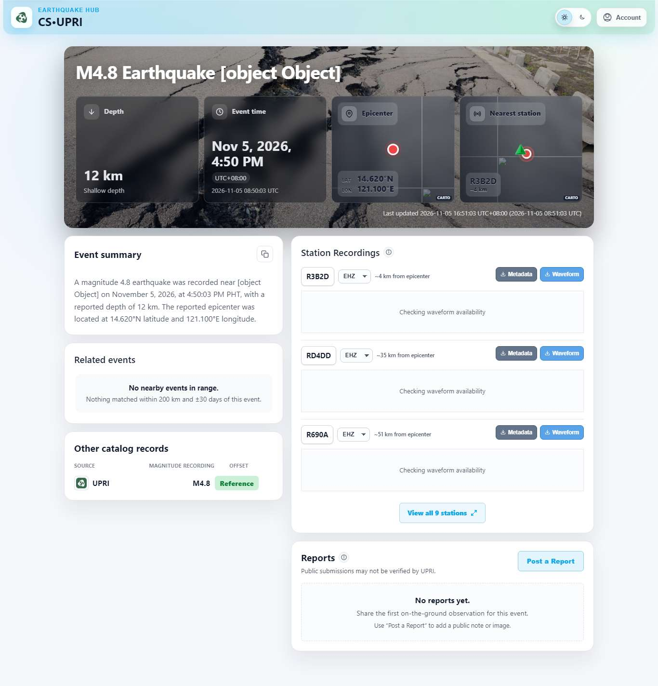

What was wrong:
- An earthquake page's title and summary fall back to the event's `location` when it has no place name. The frontend reads `location` as text.
- This branch added a GeoJSON `location` to every event for location queries (commit `6c677b6`, on `feat/db-refactor` before the PostgreSQL work), and the API started sending it. Production's events don't have it (the export has it on 0 of 906).
- So every event with no place name showed "[object Object]". That's 117 of the 906 production events (13%).
- Both backends sent it the same way, so comparing them didn't flag it. The browser test of an event with no place name did.

The fix: neither backend sends the stored point any more. It stays in the database for location queries. The pages now show the region name, as production does. Changed:
- `src/repositories/mongodb/events.repo.js` and `src/repositories/postgres/events.repo.js`
- 14 golden responses, which had recorded the point
- the API docs
- `POSTGRES.md`

**2. Fields only production has: accepted on dev, to handle before production.**

| Collection | Field | Records |
|---|---|---|
| accounts | `isActive`, `sessionVersion` | 20 |
| accounts | `adminNotificationPreferences` | 19 |
| accounts | `lastActivityAt` | 17 |
| accounts | `lastLoginAt` | 12 |
| comments | `moderationCase` | 1 |

- These fields come from the `admin-dashboard` branch, so production has run that code. Neither `dev` nor this branch has it.
- This branch on MongoDB doesn't read them. The PostgreSQL tables have no columns for them, so the copy leaves them out.
- On dev nothing uses them.
- Before production moves to PostgreSQL, the `admin-dashboard` work needs to be on this branch, with columns for these fields and a copy for them. Otherwise production loses them in the move.

**3. Two accounts with the same email, ignoring case: accepted on dev, to fix before production.**
- The accounts copy skips both and lists them by id, as `POSTGRES.md` describes.
- This branch's `migrate-unique-indexes` stops on them too, and changes nothing.
- They're the only accounts not copied: 90 of 92 accounts are in PostgreSQL.
- Before production is copied, the two need to be merged in MongoDB, or one of the emails changed.

**4. Device lists that point at missing devices: accepted.** 47 of the 110 entries in accounts' `devices[]` lists name devices that aren't in the export (removed devices). The copy can only link devices that exist, and it lists the rest. The API and the pages are the same on both backends.

**5. The significant earthquakes page: accepted.** The feature and its table were removed from the backend (the lead's decision). The frontend wasn't changed, so its page still calls the removed endpoint and shows the error. Same on both backends.

**6. Map overlays in another order: accepted.** The legend lists the overlays in the order their files finish loading. The files are static and read from disk, not the database, so the order changes from run to run on either backend.

**7. Requests the frontend cancels: accepted.** Both backends show the same two:
- The map asks for the fault lines, cancels that request, and asks again (it loads the second time).
- The live feed (`/messaging`) is closed when the page changes.

Separately, every request the test blocks (map tiles and other outside addresses) shows in the console as "Failed to load resource". How many depends on how much of the map was drawn, so the comparison checks which messages appear, not how many times.

**8. A missing uploaded image: accepted.** One production comment has an image file that lives on the server, not in the database export. Its image is broken on both backends.

**9. No edited summaries: accepted.** The page for an event with an edited summary was skipped: no production event has one. Editing and clearing a summary is covered by the API writes and the goldens.

**10. Database connections under the browser tests: fixed in the test setup, follow-up suggested.**
- What happened: with the developer `.env`, the backends looked up outside hosts that don't resolve outside production's network. Under the browser tests the PostgreSQL backend then failed requests with `KnexTimeoutError` (its connection pool was full).
- Why, most likely: the failing lookups queued up in Node's lookup threads. Opening a PostgreSQL connection needs a lookup too, so it waited behind them.
- The fix: the end-to-end backends now point every outside service at a dead local address. No timeouts since then, 0 in this run.
- Follow-up for production: if an outside host ever stops resolving there, the same could happen. Suggested: set `PG_HOST` to an IP address, or raise `UV_THREADPOOL_SIZE`.

**11. FDSN pointed at production: fixed in the test setup.** The developer `.env` sets the FDSN address to production's server. The end-to-end backends now override it, and every other outside service, with a dead local address. The comparisons were run again after the change, with the same results.

## Data: import and copy

Import (`scripts/e2e/import-prod-json.js`). Each file is one JSON array in Extended JSON (`$oid`, `$date`).

| Collection | Read | Imported | Rejected |
|---|---|---|---|
| accounts | 92 | 92 | 0 |
| devices | 26 | 26 | 0 |
| events | 906 | 906 | 0 |
| comments | 2 | 2 | 0 |
| contributionevents | 4 | 4 | 0 |

What the import found in the export:
- **Fields this branch added are missing on older records:**
  - `location`, on all 906 events and 26 devices
  - the password-policy fields, on most accounts
  - the per-catalog enrichment tracking, on 2 events

  This branch's MongoDB migrations fill them in, as deploying it would.
- **Fields only production has,** from the `admin-dashboard` branch (finding 2).
- **21 events store `legacyImportedAt` as text,** not a date.
- **One email clash, ignoring case** (finding 3). No username clashes.
- **References:** 47 device list entries point at missing devices (finding 4). Every comment's event and author, every points entry's account and event, and every event's station codes exist.

Copy to PostgreSQL (the real copy scripts, in order). Every copy's validation passed:

| Table | MongoDB | PostgreSQL | Copy report |
|---|---|---|---|
| accounts | 92 | 90 | 2 skipped (finding 3) |
| devices | 26 | 26 | 0 skipped |
| device releases | 0 | 0 | |
| brgy forwarding links | (in accounts) | 37 | 37 inserted |
| events | 906 | 906 | 0 skipped, 0 without a location |
| event stations | 6,548 | 6,548 | 0 unmatched, 0 ambiguous |
| event catalog matches | 1,204 | 1,204 | 0 unknown source, 0 duplicates |
| event catalog status | (in events) | 1,812 | one per event per catalog |
| comments | 2 | 2 | 0 skipped |
| helpful marks, issue reports | 0 | 0 | |
| contribution points | 4 | 4 | 0 skipped |

Links checked in PostgreSQL: 2 comments (event and author), 26 devices (owner), and 906 events (stations). None failed.

## API reads

`scripts/e2e/compare-api.js`: every read the frontend makes, for every record, on both backends, compared field by field.

**How strict the comparison is.** Each response is compared field by field: status code, every field present on both, the same types (a number is not a string, `null` is not a missing field) and exact values, including date formats and list order. Write flows normalize only what changes every run (new ids, this run's times, token signatures). Not compared: headers, which come from the same code on both backends, and key order, which the frontend doesn't depend on. New account and event ids are checked to be MongoDB-style (24 hex characters) by the integration tests.

| Endpoint | Requests | Identical | Documented differences only | Other differences |
|---|---|---|---|---|
| GET /eq-events (each event in the list) | 906 | 50 | 856 (`onlineStations` 2, `createdAt` 721, `__v` 682, `legacyImportedAt` 847, `legacySourcePublicID` 847, `candidateStations` 14, `catalogEnrichmentAttempts` 835, `catalogEnrichmentStatus` 2) | 0 |
| GET /eq-events (order) | 906 / 906 events | same order | | |
| GET /eq-events/:publicID | 906 | 50 | 856 (`onlineStations` 2, `createdAt` 721, `__v` 682, `legacyImportedAt` 847, `legacySourcePublicID` 847, `candidateStations` 14, `catalogEnrichmentAttempts` 835, `catalogEnrichmentStatus` 2) | 0 |
| GET /comments | 906 | 906 | 0 | 0 |
| GET /comments (by cursor) | 2 | 2 | 0 | 0 |
| GET /comments (by offset) | 2 | 2 | 0 | 0 |
| GET /device/all | 1 | 1 | 0 | 0 |
| GET /device/status | 26 | 26 | 0 | 0 |
| GET /accounts/ringserver-hosts | 1 | 1 | 0 | 0 |
| GET /accounts/profile | 3 | 3 | 0 | 0 |
| GET /device/my-devices | 3 | 3 | 0 | 0 |

The documented differences are the ones `POSTGRES.md` lists ("What the API shows differently after the switch"). The frontend reads none of them:
- `legacyImportedAt` and `legacySourcePublicID`: missing on old MongoDB records, `null` in PostgreSQL
- `createdAt` and `__v`: missing on old MongoDB records, always set in PostgreSQL
- `catalogEnrichmentAttempts` and `catalogEnrichmentStatus`: the copy turned the old single counter into one per catalog
- `candidateStations`: old records only had `onlineStations`
- `onlineStations`: the same stations, nearest first

## API writes

`scripts/e2e/compare-writes.js`: every write flow, step by step with the same input on both backends, compared after the goldens' normalization. 49 steps, 49 the same, 0 different.

| Flow | Steps |
|---|---|
| Accounts | register, sign in, profile, alert preferences, change username, email and password, sign out, forgot and reset password (through the mail catcher), sign in again, delete |
| Sensors | register an owner, link a sensor, station status as the ringserver sends it, my devices, unlink, link again, reset the link, delete the owner |
| Brgy | forward a sensor, the brgy's list, stop forwarding |
| Reports | post (text, anonymous, image only), list, mark helpful (twice), unmark, report an issue (twice), reject, delete, list again |
| Summary | edit, read, clear, read |
| SeisComP | a new event, its live-feed message, the event after its station check, an older update (dropped), a newer update, the event after |

## Frontend

The browser tests (`e2e/frontend`, Playwright) ran the unchanged frontend once against each backend and compared what each page showed: its visible text, console errors and failed requests. Personal data was blanked before each screenshot. 13 tests on each backend: 24 passed, 2 skipped (the edited-summary page, finding 9).

| Page | Verdict | Console errors and failed requests (same on both) |
|---|---|---|
| Home: map and events panel | same content, other order (Fault Lines, Plate Boundaries) | `Failed to load resource: net::ERR_FAILED` `GET /overlays/faults` |
| Earthquake page: matched in PHIVOLCS and USGS | same | `Failed to load resource: net::ERR_FAILED` `Failed to load resource: net::ERR_UNSAFE_PORT` |
| Earthquake page: legacy record | same | `Failed to load resource: net::ERR_FAILED` `Failed to load resource: net::ERR_UNSAFE_PORT` |
| Earthquake page: no place name | same | `Failed to load resource: net::ERR_FAILED` `Failed to load resource: net::ERR_UNSAFE_PORT` |
| Earthquake page: with a report | same | `Failed to load resource: net::ERR_FAILED` `Failed to load resource: net::ERR_UNSAFE_PORT` |
| Significant earthquakes (removed) | same | `Failed to load resource: net::ERR_FAILED` `Failed to load resource: the server responded with a status of 404 (Not Found)` `Error fetching significant EQs: AxiosError: Request failed with status code 404` |
| Reset password (an invalid link) | same | `Failed to load resource: net::ERR_FAILED` |
| Citizen: dashboard | same | `Failed to load resource: net::ERR_FAILED` `GET /overlays/faults` |
| Citizen: account settings | same | `Failed to load resource: net::ERR_FAILED` `GET /overlays/faults` |
| Sensor owner: dashboard | same | `Failed to load resource: net::ERR_FAILED` `GET /overlays/faults` |
| Sensor owner: account settings | same | `Failed to load resource: net::ERR_FAILED` `GET /overlays/faults` |
| Brgy: dashboard | same content, other order (Plate Boundaries, Fault Lines) | `Failed to load resource: net::ERR_FAILED` `GET /overlays/faults` |
| Brgy: account settings | same content, other order (Plate Boundaries, Fault Lines) | `Failed to load resource: net::ERR_FAILED` `GET /overlays/faults` |
| Register a new account | same | `Failed to load resource: net::ERR_FAILED` `GET /overlays/faults` |
| Post a report | same | `Failed to load resource: net::ERR_FAILED` `Failed to load resource: net::ERR_UNSAFE_PORT` `GET /messaging` |
| Mark a report helpful (another account) | same | `Failed to load resource: net::ERR_FAILED` `Failed to load resource: net::ERR_UNSAFE_PORT` `GET /messaging` |

None of these comes from the backends:
- **`net::ERR_FAILED`:** the outside addresses the test blocks, such as map tiles.
- **`net::ERR_UNSAFE_PORT`:** the waveform and sensor feeds. The test points them at port 9, a dead local address, and the browser refuses that port.
- **`GET /overlays/faults` and `GET /messaging`:** requests the frontend cancels itself (finding 7).
- **The 404s:** the removed significant earthquakes endpoint (finding 5).

### Screenshots

MongoDB on the left, PostgreSQL on the right. Map tiles are blank on purpose: the tests block every outside address.

**Home: map and events panel**

<table><tr>
<td>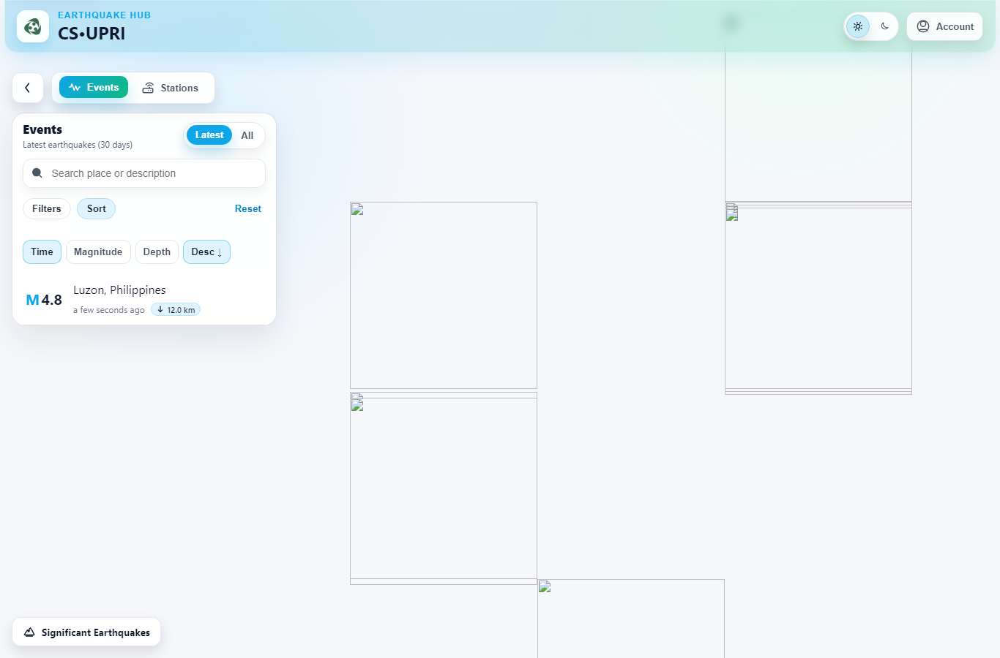</td>
<td>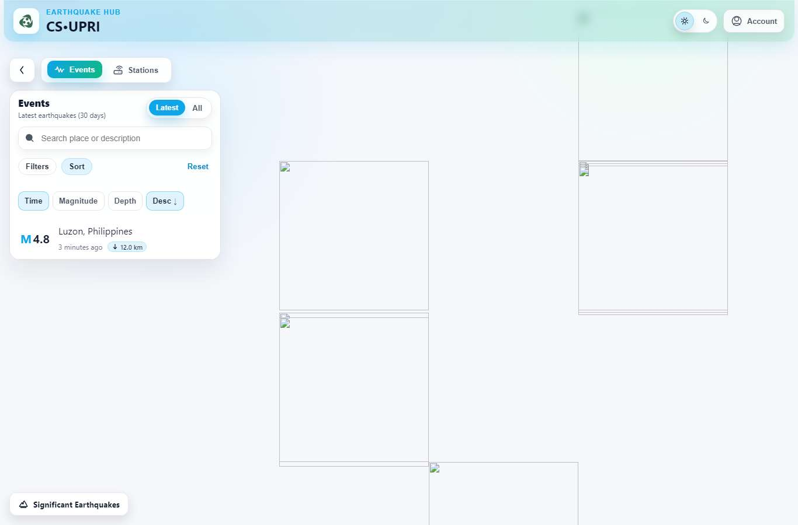</td>
</tr></table>

**Earthquake page: matched in PHIVOLCS and USGS**

<table><tr>
<td></td>
<td>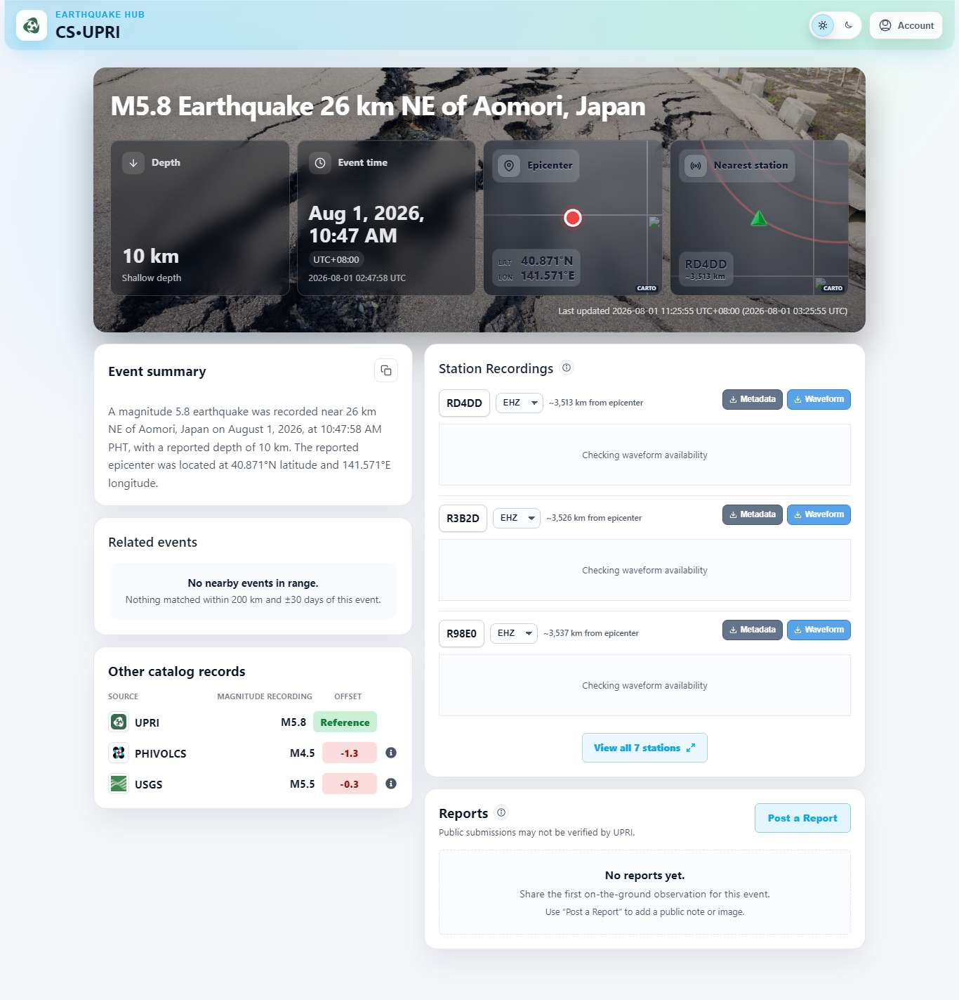</td>
</tr></table>

**Earthquake page: no place name**

<table><tr>
<td>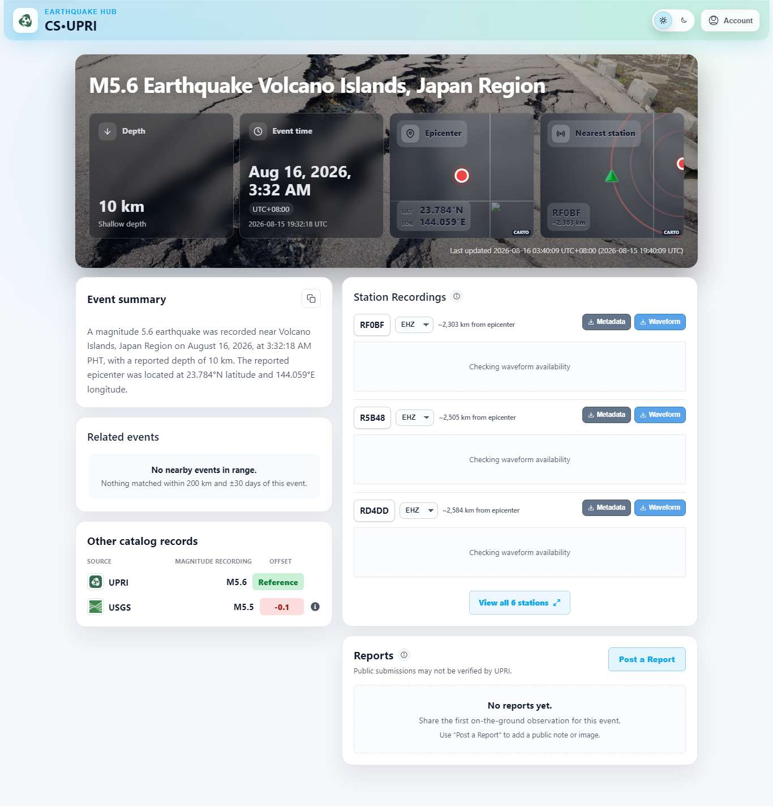</td>
<td></td>
</tr></table>

**Earthquake page: with a report**

<table><tr>
<td></td>
<td></td>
</tr></table>

**Significant earthquakes (removed)**

<table><tr>
<td>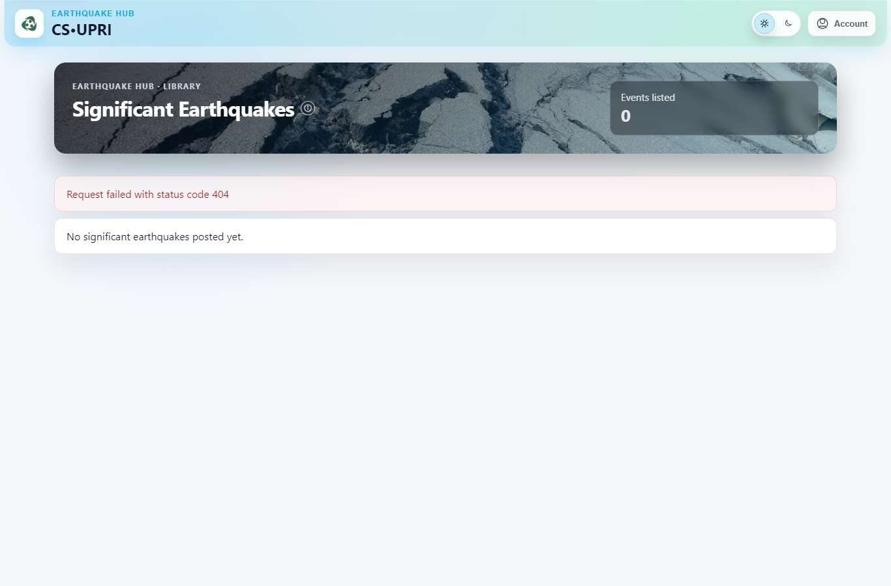</td>
<td></td>
</tr></table>

**Citizen: dashboard**

<table><tr>
<td></td>
<td>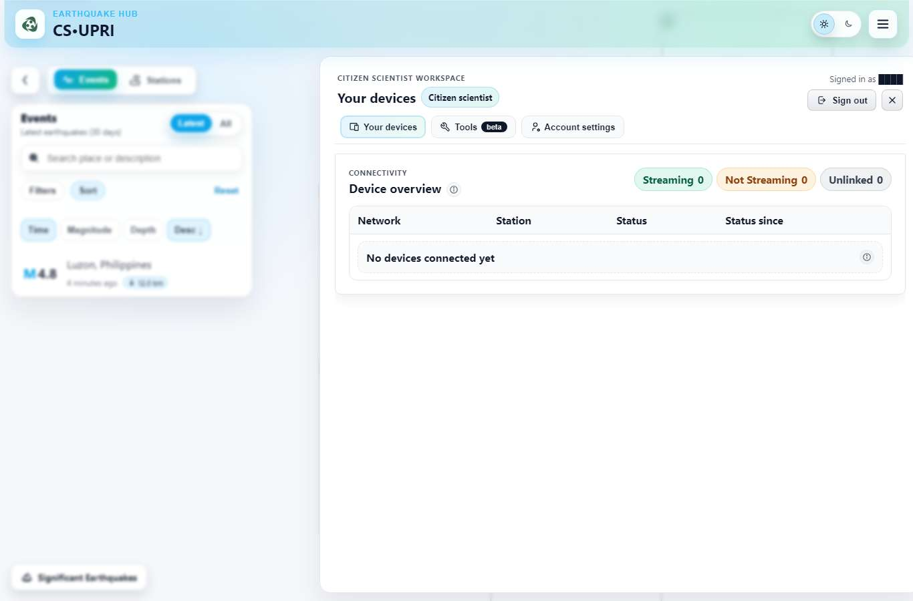</td>
</tr></table>

**Citizen: account settings**

<table><tr>
<td>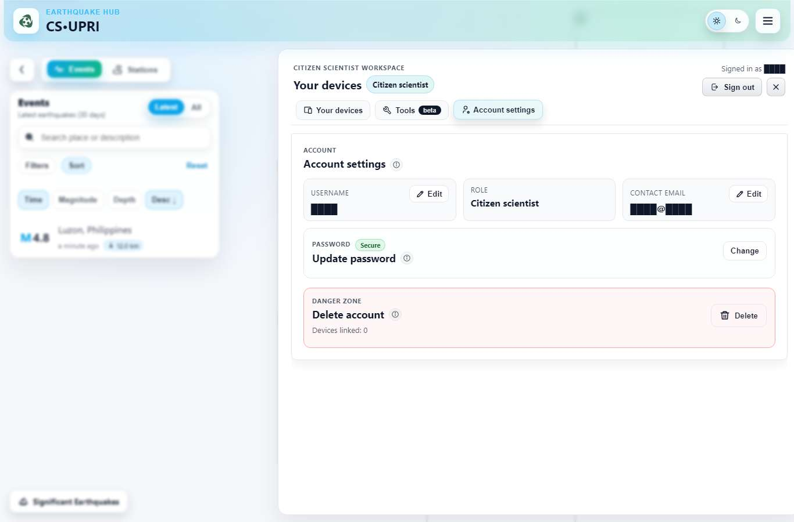</td>
<td></td>
</tr></table>

**Sensor owner: dashboard**

<table><tr>
<td></td>
<td>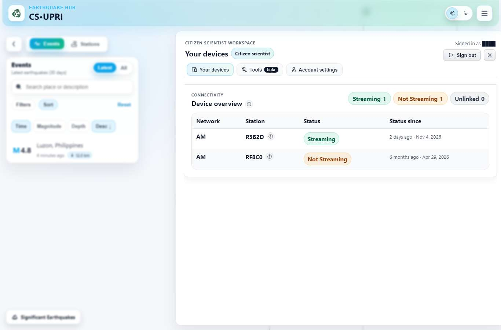</td>
</tr></table>

**Brgy: dashboard**

<table><tr>
<td></td>
<td>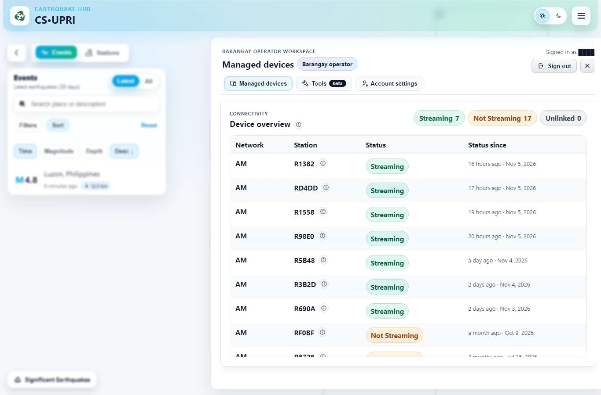</td>
</tr></table>

**Post a report**

<table><tr>
<td></td>
<td>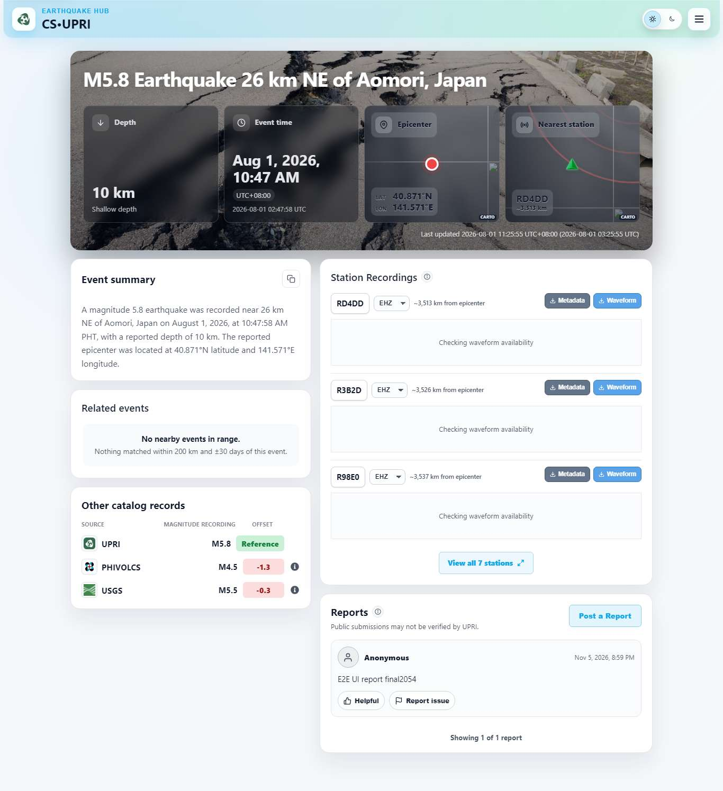</td>
</tr></table>

## Coverage

Every backend call the frontend makes, and where it was compared:

| Frontend call | Tables | Reads | Writes | Pages | Goldens |
|---|---|---|---|---|---|
| `GET /eq-events`, `GET /eq-events/:id` | events, event stations, catalog matches and status | every event | yes | home, earthquake pages | yes |
| `PATCH`, `DELETE /eq-events/:id/summary` | events | | yes | | yes |
| `GET /comments`; `POST /comments`; `PUT`, `DELETE /comments/:id/helpful`; `POST /comments/:id/issues` | comments, helpful marks, issue reports, contribution points | every event | yes | reports | yes |
| `/accounts/*` (register, authenticate, signout, profile, username, email, password, alert-preferences, forgot-password, reset-password, delete) | accounts | profile | yes | sign-in, dashboards, account settings, register | yes |
| `GET /accounts/ringserver-hosts` | accounts | yes | | | yes |
| `POST /accounts/acquire-brgy-token` | accounts | | | brgy dashboard | yes |
| `GET /device/all`, `/device/status`, `/device/my-devices` | devices, brgy forwarding | every device | yes | home, dashboards | yes |
| `GET /device/remote-actions/capabilities`, `/servers` | devices | | | | yes |
| `POST /device/remote-actions/execute` | devices | | | | no: needs a device tunnel, which the test can't reach |
| `POST /device/add` | none | | | | yes: the route doesn't exist, 404 on both |
| `GET /messaging` (live feed) | events | | yes | every page | yes |
| `GET /overlays/*` | none (static files) | | | home | |
| `GET /significant-eqs/all` | removed | | | significant earthquakes page | |

Tables no frontend call reaches:
- `job_locks`: the background jobs' locks, covered by the Step 1 tests.
- `device_releases`: written when a device is unlinked. Covered by the unlink write steps and the goldens. Production has none.

## Re-run after Part 4

Part 4 removes MongoDB and the copy scripts. To re-run then:
1. Restore PostgreSQL from the saved baseline (`baseline/postgres.dump`).
2. Run only the PostgreSQL backend.
3. Compare its responses with `baseline/api-reads.json` and `baseline/api-writes.json`, the MongoDB responses saved in this run.

Results: *(to be added after Part 4)*
